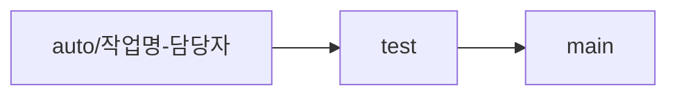

# 39-STUDY-WEB-OPTIMUS

PLAY SOPT 39기 WEB 자동화 스터디

## 🤖 옵티머스 OPTIMUS

**단순 반복적인 협업 프로세스를 자동화하여 팀의 생산성을 최적화하는 스터디**  
PLAY SOPT 39기 WEB · DevOps · Automation · AI · Collaboration

---

### 🤖 About OPTIMUS

> 💡 **`개발하기도 바쁜데 이거 누가 자동으로 좀 해줬으면…` 하는 순간을 해결합니다**

옵티머스는 개발 협업 과정에서 발생하는 문제를 자동화와 AI를 활용해 직접 해결해보는 스터디입니다.  
합동세미나, 앱잼처럼 바쁜 프로젝트 기간에 바로 가져다 쓸 수 있도록 자동화와 DevOps 환경을 미리 만들어두고 공유해요.

- ⏱ 눈 깜빡하면 쌓여있는 PR
- 🥲 아무도 안 단 코드 리뷰
- 🔁 매번 손으로 하는 반복 작업

---

### 🎯 Study Goal

#### 1. 프로젝트를 위한 사전 준비

> 합동세미나, 앱잼 전에 자동화와 DevOps 환경을 미리 구축해 협업 효율을 개선합니다.

#### 2. 반복 작업의 자동화

> PR, 코드 리뷰, 배포 등에서 발생하는 협업 문제를 자동화로 해결합니다.

#### 3. 포트폴리오로 이어지는 경험

> 실제 협업 문제를 개선한 자동화 결과물을 포트폴리오에 활용할 수 있는 경험으로 남깁니다.

---

### 🛠️ 스터디 진행 방식

> 총 8주간, 주 1회 비대면으로 진행해요.

**📌 구현 & 테스트** (스터디 2일 전까지)

- 주차별 담당자가 자동화 기능을 구현해요.
- 작업 브랜치에서 작업 후 `test` 브랜치로 PR을 생성하고, 머지하여 실제 동작을 확인해요.
- 테스트가 완료되면 `test → main` PR을 생성하고, PR 링크를 과제란에 제출해요.

**📌 코드 리뷰** (스터디 시작 1시간 전까지)

- 다른 스터디원들은 `test → main` PR의 내용과 코드를 기반으로 리뷰를 진행해요.
- 1인당 **최소 2개 이상**의 코드 리뷰를 작성해요.

**📌 발표**

- 구현자는 문서화 내용(마크다운 추천)을 기반으로 발표해요.
- 구현한 자동화 기능 설명, 동작 방식 및 테스트 결과를 공유해요.
- 발표 후 자유롭게 Q&A를 진행해요.

---

### 👥 Members

> 각 팀원은 하나의 협업 문제를 정의하고, 자동화로 해결합니다.

|  |  |  |
| :----------------------------------------------------: | :-------------------------------------------------------: | :------------------------------------------------------: |
|                       **강효정**                       |                        **김유민**                         |                        **김희수**                        |
|         [@ahyohyo](https://github.com/ahyohyo)         |       [@yumin-kim2](https://github.com/yumin-kim2)        |        [@kimxeesoo](https://github.com/kimxeesoo)        |

 

|  |  |  |
| :----------------------------------------------------: | :-------------------------------------------------------: | :---------------------------------------------------: |
|                       **박우찬**                       |                        **심민식**                         |                      **조영찬**                       |
|         [@pwc2002](https://github.com/pwc2002)         |       [@minsik1014](https://github.com/minsik1014)        |         [@ychany](https://github.com/ychany)          |

---

### 🌿 Branch Strategy

#### 📌 브랜치명

- 형식: `auto/{작업명}-{담당자}`
- 예시: `auto/pr-reviewer-hyojeong`, `auto/deploy-preview-yumin`
- 각 자동화 작업은 자신의 작업 브랜치에서 진행합니다.

#### 📌 브랜치 흐름

| 브랜치   | 역할                                     |
| :------- | :--------------------------------------- |
| `auto/*` | 자동화 기능 구현                         |
| `test`   | 머지 후 실제 동작 검증                   |
| `main`   | 테스트 완료 + 코드 리뷰를 거친 최종 반영 |

---

### ✍️ Convention

#### 📌 커밋 메시지

- 형식: `{type}: {작업 내용}`
- 예시: `feat: PR 생성 시 리뷰어 자동 할당 워크플로우 추가`

| type       | 설명                             |
| :--------- | :------------------------------- |
| `feat`     | 새로운 자동화 기능 추가          |
| `fix`      | 버그 수정                        |
| `refactor` | 동작 변화 없는 코드 개선         |
| `docs`     | 문서 수정 (README, 발표 자료 등) |
| `chore`    | 설정, 기타 작업                  |

#### 📌 PR 제목

- `auto → test` 형식: `[Week {n}][Test] {작업명}`
- `test → main` 형식: `[Week {n}][Main] {작업명}`
- 예시: `[Week 2][Main] PR 리뷰어 자동 할당`

#### 📌 PR 내용

- 해결하려는 협업 문제
- 구현한 자동화 기능 및 동작 방식
- 테스트 결과 (스크린샷, 실행 로그 등)
- 어려웠던 점
