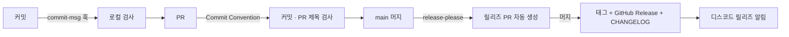

# 🏷️ 커밋 컨벤션 & 릴리즈 자동화

커밋 메시지 규칙을 자동으로 검사하고, 규칙을 지킨 커밋을 근거로 버전 · 릴리즈 노트 · 디스코드 알림까지 자동으로 만드는 자동화예요.

---

### 📌 전체 흐름



---

### 📌 1. 커밋 컨벤션 검사

규칙은 `.githooks/commit-msg` 한 곳에 있고, 로컬 훅과 CI 가 같은 스크립트를 실행해요.

- 형식: `{type}: {작업 내용}` — scope `feat(bot): ...` 와 breaking change `feat!: ...` 도 허용
- type: `feat` `fix` `refactor` `docs` `chore`
- `Merge ...` · `Revert ...` 처럼 git 이 만드는 메시지는 통과

| 위치 | 언제 | 실패하면 |
| :-- | :-- | :-- |
| 로컬 (`commit-msg` 훅) | `git commit` 할 때 | 커밋이 만들어지지 않아요 |
| CI (`commit-convention.yml`) | PR 생성 · 푸시 · 제목 수정 | 체크 실패 + PR 에 결과 댓글 |

CI 는 PR 제목이 `[Week {n}][Test|Main] {작업명}` 형식인지도 함께 검사해요. (release-please 의 릴리즈 PR 은 제외)

**로컬 훅 켜기** (클론 후 한 번)

```bash
git config core.hooksPath .githooks
```

---

### 📌 2. 릴리즈 자동화

[release-please](https://github.com/googleapis/release-please) 를 사용해요.

1. `main` 에 커밋이 쌓이면 **릴리즈 PR** (`chore: release 1.1.0`) 을 자동으로 열고, 커밋이 추가될 때마다 갱신해요.
2. 릴리즈 PR 에는 다음 버전, `CHANGELOG.md`, `version.txt` 변경이 들어 있어요.
3. 릴리즈 PR 을 머지하면 태그(`v1.1.0`)와 GitHub Release 를 발행하고 디스코드로 알려요.

| type | 버전 변화 | 릴리즈 노트 섹션 |
| :-- | :-- | :-- |
| `feat!` / `BREAKING CHANGE` | major | ⚠ BREAKING CHANGES |
| `feat` | minor | ✨ 새로운 기능 |
| `fix` | patch | 🐛 버그 수정 |
| `refactor` | patch | ♻️ 리팩토링 |
| `docs` | patch | 📝 문서 |
| `chore` | 없음 | 표시 안 함 |

첫 릴리즈는 `1.0.0` 이에요. (`release-please-config.json` 의 `initial-version`)

---

### 📌 다른 레포에 적용하기

#### 1. 파일 복사

- `.githooks/commit-msg`
- `.github/workflows/commit-convention.yml`, `.github/scripts/check-convention.sh`
- `.github/workflows/release.yml`, `.github/scripts/discord-release-notify.sh`
- `release-please-config.json`, `.release-please-manifest.json`

> Node 프로젝트라면 `release-please-config.json` 의 `release-type` 을 `node` 로 바꾸면 `package.json` 버전도 함께 올라가요.

#### 2. 레포 설정

- **Settings → Actions → General → Workflow permissions** 에서 **Allow GitHub Actions to create and approve pull requests** 체크 (릴리즈 PR 생성에 필요)

#### 3. Repository Secrets

| Secret | 값 |
| :-- | :-- |
| `DISCORD_BOT_TOKEN` | 디스코드 봇 토큰 (Week 1 PR 봇과 공유) |
| `DISCORD_RELEASE_CHANNEL_ID` | 릴리즈 알림 채널 id |

---

### 📌 참고

- 릴리즈 PR 은 `GITHUB_TOKEN` 으로 만들어져서 다른 워크플로(PR 디스코드 봇, 컨벤션 검사)가 실행되지 않아요. GitHub 의 무한 루프 방지 정책이에요.
- 같은 이유로 `release: published` 이벤트도 발생하지 않아서, 디스코드 알림은 `release.yml` 안에서 이어서 보내요.
