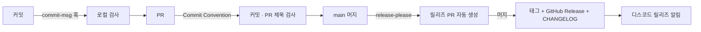

# 🏷️ 커밋 컨벤션 & 릴리즈 자동화

커밋 메시지 규칙을 자동으로 검사하고, 규칙을 지킨 커밋을 근거로 버전 · 릴리즈 노트 · 디스코드 알림까지 자동으로 만드는 자동화예요.

---

### 📌 전체 흐름



---

### 📌 1. 커밋 컨벤션 검사

규칙은 `.githooks/commit-msg` 한 곳에 있고, 로컬 훅과 CI 가 같은 스크립트를 실행해요.

- 형식: `{type}: {작업 내용}` — scope `feat(bot): ...` 와 breaking change `feat!: ...` 도 허용
- type: `feat` `fix` `refactor` `docs` `chore`
- `Merge ...` · `Revert ...` 처럼 git 이 만드는 메시지는 통과

| 위치 | 언제 | 실패하면 |
| :-- | :-- | :-- |
| 로컬 (`commit-msg` 훅) | `git commit` 할 때 | 커밋이 만들어지지 않아요 |
| CI (`commit-convention.yml`) | PR 생성 · 푸시 · 제목 수정 | 체크 실패 + PR 에 결과 댓글 |

CI 는 PR 제목이 `[Week {n}][Test|Main] {작업명}` 형식인지도 함께 검사해요. (release-please 의 릴리즈 PR 은 제외)

CI 는 PR 이 아니라 **base 브랜치의 규칙 파일**로 검사해요. 규칙을 바꾸는 PR 이 바뀐 규칙으로 자기 자신을 통과시키지 못하게 하고, PR 코드를 실행하는 검사 단계(읽기 전용)와 결과 댓글 단계(쓰기)를 분리했어요. 커밋 목록 조회에 실패하면 통과가 아니라 실패로 처리해요.

**로컬 훅 켜기** (클론 후 한 번)

```bash
git config core.hooksPath .githooks
```

---

### 📌 2. 릴리즈 자동화

[release-please](https://github.com/googleapis/release-please) 를 사용해요.

1. `main` 에 커밋이 쌓이면 **릴리즈 PR** (`chore: release 1.1.0`) 을 자동으로 열고, 커밋이 추가될 때마다 갱신해요.
2. 릴리즈 PR 에는 다음 버전, `CHANGELOG.md`, `version.txt` 변경이 들어 있어요.
3. 릴리즈 PR 을 머지하면 태그(`v1.1.0`)와 GitHub Release 를 발행하고 디스코드로 알려요.

| type | 버전 변화 | 릴리즈 노트 섹션 |
| :-- | :-- | :-- |
| `feat!` / `BREAKING CHANGE` | major | ⚠ BREAKING CHANGES |
| `feat` | minor | ✨ 새로운 기능 |
| `fix` | patch | 🐛 버그 수정 |
| `refactor` | patch | ♻️ 리팩토링 |
| `docs` | patch | 📝 문서 |
| `chore` | 없음 | 표시 안 함 |

첫 릴리즈는 `1.0.0` 이에요. (`release-please-config.json` 의 `initial-version`)

---

### 📌 다른 레포에 적용하기

#### 1. 파일 복사

- `.githooks/commit-msg`
- `.github/workflows/commit-convention.yml`, `.github/scripts/check-convention.sh`
- `.github/workflows/release.yml`, `.github/scripts/discord-release-notify.sh`
- `release-please-config.json`, `.release-please-manifest.json`

> Node 프로젝트라면 `release-please-config.json` 의 `release-type` 을 `node` 로 바꾸면 `package.json` 버전도 함께 올라가요.

#### 2. 릴리즈 PR 용 토큰 만들기

SOPT-all 처럼 조직이 **GitHub Actions 의 PR 생성을 막아둔 경우** `GITHUB_TOKEN` 으로는 릴리즈 PR 을 만들 수 없어서 개인 토큰(PAT)을 사용해요.

1. [Fine-grained token 생성](https://github.com/settings/personal-access-tokens/new)
2. Resource owner: 조직 · Repository access: 대상 레포만
3. Permissions: **Contents** `Read and write`, **Pull requests** `Read and write`

> 조직이 Actions 의 PR 생성을 허용한다면 PAT 없이 레포 **Settings → Actions → General → Allow GitHub Actions to create and approve pull requests** 만 체크하고, `release.yml` 의 `token` 을 `secrets.GITHUB_TOKEN` 으로 바꿔도 돼요.

#### 3. Repository Secrets

| Secret | 값 |
| :-- | :-- |
| `RELEASE_PLEASE_TOKEN` | 위에서 만든 토큰 |
| `DISCORD_BOT_TOKEN` | 디스코드 봇 토큰 (Week 1 PR 봇과 공유) |
| `DISCORD_RELEASE_CHANNEL_ID` | 릴리즈 알림 채널 id |

---

### 📌 참고

- 릴리즈 PR 을 PAT 로 만들기 때문에 다른 PR 처럼 디스코드 PR 봇과 컨벤션 검사가 실행돼요. (`GITHUB_TOKEN` 으로 만든 PR 은 무한 루프 방지 정책 때문에 다른 워크플로를 트리거하지 않아요)
- 디스코드 릴리즈 알림은 별도 `release: published` 워크플로 대신 `release.yml` 안에서 이어서 보내요. 릴리즈가 만들어진 직후 같은 실행 안에서 보내서 토큰 종류와 상관없이 동작해요.
- 릴리즈 PR 작성자는 토큰을 만든 사람 계정으로 표시되고, 토큰이 만료되면 릴리즈 PR 이 만들어지지 않으니 만료일을 챙겨주세요.
- 릴리즈 PR 은 머지하기 전까지 계속 열려 있고, `main` 에 머지될 때마다 같은 PR 이 갱신돼요. PR 리뷰 리마인드 봇이 이 PR 을 "리뷰어 미지정"으로 매일 알리지 않도록, 리마인드 제외 라벨에 release-please 가 자동으로 붙이는 `autorelease: pending` 을 추가해주세요.
